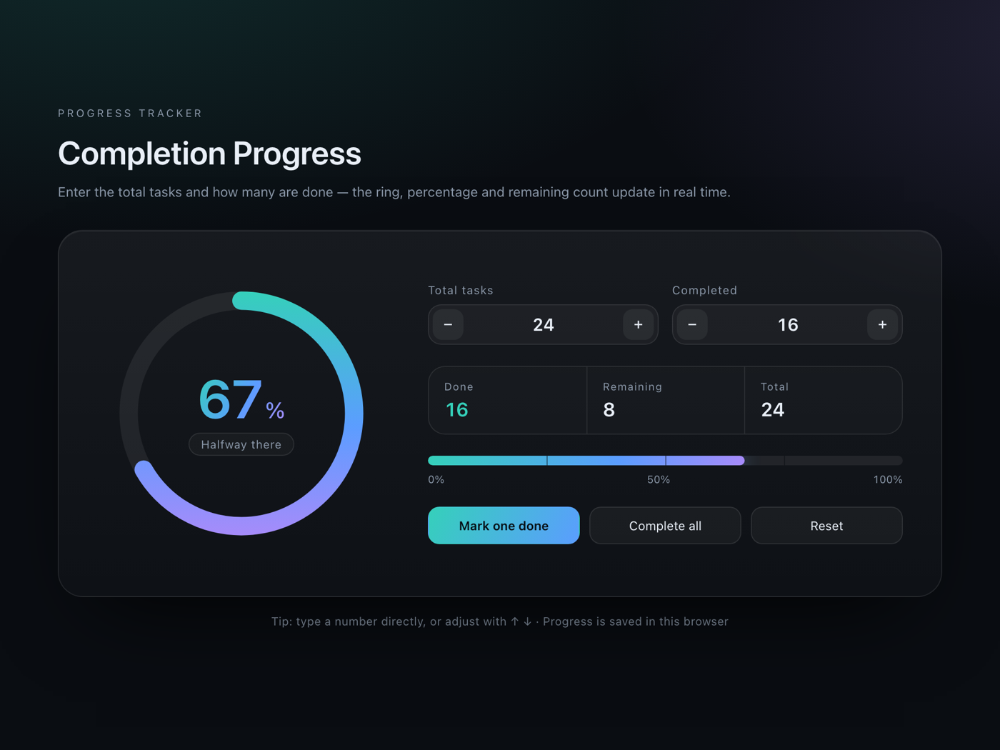

# Completion Progress

A dependency-free, single-file progress visualizer. Enter the total number of tasks and how many are done, and the page renders the completion ratio as an animated gradient ring, a large percentage figure, and a milestone progress bar.



## Features

- **Animated SVG ring** — gradient stroke driven by `stroke-dasharray` / `stroke-dashoffset`, with a 520 ms ease-out transition
- **Live figures** — percentage, status badge, and done / remaining / total counters
- **Milestone bar** — horizontal bar with 25% / 50% / 75% tick marks, synced to the same animation value as the ring
- **Flexible input** — stepper buttons, direct typing, or the ↑ / ↓ keys
- **Quick actions** — mark one done, complete all, reset
- **Auto-save** — state persisted to `localStorage`, restored on reload
- **Accessible** — `role="progressbar"` with live `aria-valuenow` / `aria-valuetext`
- **Responsive** — two columns on desktop, single column below 760 px
- **Reduced motion** — animations respect `prefers-reduced-motion`

## Files

| File | Description |
| --- | --- |
| `index.html` | English version |
| `index.zh.html` | Chinese version |
| `preview.png` | Screenshot used in this README |

## Usage

Open `index.html` in any modern browser. No build step, no dependencies, no network requests.

## Deploy with GitHub Pages

1. Push this repository to GitHub.
2. Open **Settings → Pages**.
3. Under **Build and deployment**, select **Deploy from a branch**, branch `main`, folder `/ (root)`.
4. The site is published at `https://<username>.github.io/<repository>/`.

## Customization

Colors are defined in the `:root` block at the top of `index.html`:

```css
:root {
  --teal:   #35d0ba;
  --blue:   #5b9dff;
  --violet: #a78bfa;
}
```

Changing these three variables re-skins the ring, the percentage text, the progress bar, and the primary button together.

## Browser support

Tested in current versions of Chrome, Safari, and Firefox. The layout uses CSS Grid and `aspect-ratio`; `backdrop-filter` degrades to a solid panel on browsers that do not support it.

## License

MIT — see [LICENSE](LICENSE).
